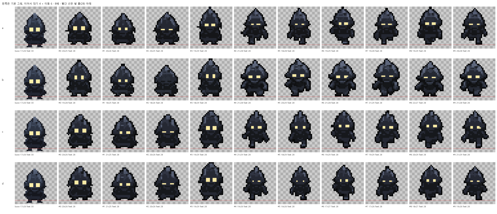

# 애니메이션 축척·이동 6프레임 시험 (애니메이션 Phase 1, T1.A.1)

_2026-09-25, sprite-gen 2.9.0(`b65058c`) + codex CLI 0.155(Codex 앱). 스크립트 `scripts/animation_trial.py`_

## 조건

- 기본 그림: 스튜디오 에셋 `622203551b15`(LAST LIGHT 그림자 적, 32×32 중 17×26칸, 12색, 설명 "a creeping shadow creature enemy with two glowing eyes"). processed 32×32를 최근접 32배(1024×1024)로 키워 썼다. 사용자 `data/`는 읽기만 했다.
- OpenAI로 보낸 것: 키운 기본 그림, sprite-gen 배치 가이드, 프롬프트. (a)와 (b) 두 번, 줄 4개다.
- sprite-gen `prepare`: `--cell-size 32 --safe-margin 3 --fit-pixel-unfake --fit-palette-size 12 --fit-align-x foot-centroid --fit-align-y bottom --fit-ground-frames`
- 상태: `idle` 4프레임("subtle breathing and blinking"), `frontwalk` 6프레임("creeping walk toward the viewer")
- `gen-set --provider codex --concurrency 2`. 하위 프로세스 PATH 앞에 Codex 앱의 codex 폴더를 붙였다.

## 계획과 다르게 한 것: (c)

계획의 (c)는 `prepare --fit-logical-height 26`으로 다시 추출해 넘치는 프레임을 줄이는 것이었다. sprite-gen 2.9.0에서는 할 수 없다.

- 논리 높이로 눌러 줄이는 기능(`conform`)은 2026-07-14·17에 빠졌다(`frames/extract.py` 주석: 칸을 병합해 디테일을 갈라먹는다).
- 지금 `logical_height`는 정수 격자 배율만 정한다. 칸 32에 26을 주면 배율이 `32 // 26 = 1`이라, 논리 높이는 32로 돌아가고 경고만 난다.
- 남은 축소는 물리 상한뿐이다. 줄에서 가장 큰 프레임이 `칸 - 여백`(32 - 3 = 29)을 넘으면, 그 줄 전체를 한 배율로 kCentroid 축소한다.

그래서 (c)와 (d)를 새로 정했다. 둘 다 codex를 다시 부르지 않는다.
- (a)의 원본 줄을 64 칸(상한 61)으로 다시 추출해, 줄이지 않은 원래 크기의 프레임을 얻는다(`native`).
- 스튜디오에서 kCentroid 방식으로 줄여 32×32 발 줄(28)에 세운다.
  - (c)는 10프레임 모두 한 배율(대기 높이 중앙값 → 기본 그림 높이)을 쓴다.
  - (d)는 줄마다 자기 배율(그 줄 높이 중앙값 → 기본 그림 높이)을 쓴다.
- 줄일 때 칸 색은 우세 군집의 평균 대신 가장 흔한 색으로 했다. 새 색이 생기지 않게 하려는 것이다.

## 결과

왼쪽 끝이 기본 그림이고, 이어서 대기 4 + 이동 6이다. 8배이고, 빨간 선은 발 줄(28) 바로 아래다. 기본 그림의 발은 30번째 줄이다(발 줄 수정 전에 만든 에셋).

| | 생성 시간(대기, 이동) | codex가 그린 원래 크기(대기 / 이동) | 최종 높이 중앙값(대기 / 이동) | 기본 그림과 차이 | 색 수 |
|---|---|---|---|---|---|
| (a) 설명 그대로 | 64초, 60초 | 26~28×33~40 / 24~28×38~39 | 25 / 28 | -1 / +2 | 16 |
| (b) + 크기 힌트 | 66초, 51초 | 25~26×33~40 / 22~23×29~31 | 26.5 / 28 | +0.5 / +2 | 19 |
| (c) 한 배율 | (a) 재사용 | (a)와 같음 | 26 / 29 | 0 / +3 | 16 |
| (d) 줄마다 배율 | (a) 재사용 | (a)와 같음 | **26 / 26** | **0 / 0** | 16 |

- 크기 힌트의 효과는 판단할 수 없었다(변형마다 한 번씩만 돌렸다). (d)가 크기를 맞추므로 힌트는 필요 없다.
  - codex는 두 번 모두 기본 그림보다 촘촘한 격자로 더 크게 그렸다. 대기는 두 번 다 33~40칸이었다(기본 26칸).
  - (a)와 (b)의 최종 높이가 26에 가까운 것은 sprite-gen 상한(29)이 줄였기 때문이다. 힌트 덕분이 아니다.
  - (b)의 이동 줄은 원래 크기가 29~31칸으로 (a)(38~39)보다 작았다. 다만 가로 격자와 세로 격자가 달리 잡혔다(sprite-gen 경고 "axis ratio y/x disagrees"). 폭이 21~22칸으로 뚱뚱해 다른 캐릭터처럼 보였다.
- 상한 축소는 줄마다 가장 큰 프레임을 기준으로 한다. (a)는 대기를 0.725배, 이동을 0.744배로 줄였다. 그 결과 걷기 시작하면 적이 3칸 커진다(대기 25, 이동 28).
- (d)는 대기와 이동이 모두 26칸이다.
  - 이동 프레임은 16~19×26~27로 기본 그림(17×26)에 가장 가깝다.
  - 대기 프레임은 20~21칸 폭으로 기본 그림보다 통통하다. 3번 프레임은 두건 끝이 솟아 29칸이다.
  - 1px 윤곽이 살아 있고, 눈도 남았다. 이동 줄의 눈은 1칸 높이로 작아졌다.
- 색: sprite-gen `palette.lock.json`은 12색이지만, 프레임에는 16~19색이 있다. 스튜디오가 10프레임을 함께 보고 `max_colors`로 접어야 한다.
- 이동 6프레임: (a)와 (b) 모두 6프레임이 나왔고 다리가 번갈아 움직였다. 형태 붕괴는 없었다. sprite-gen `inspect`도 통과했다.
- 시간: 한 줄에 51~66초, 두 줄을 동시에 돌려 약 65초

움직임: [(a) GIF](animation-trial-a.gif), [(d) GIF](animation-trial-d.gif)(게임 시간: 대기 0.18초, 이동 0.1초)

## 결론 (결정 규칙 적용)

1. 규칙 1(크기 힌트)은 쓰지 않는다. (b)가 ±1칸 안에 든 것은 상한 때문이고, 이동 줄은 폭이 뚱뚱해졌다.
2. 규칙 2(후처리)를 바뀐 형태로 쓴다. 방식은 (d)다. 실행기는 다음과 같이 한다.
   - 생성은 프로젝트 칸(32×32, 여백 = 발 줄)으로 한다.
   - 추출은 두 배 칸(64×64)의 별도 run 폴더에서 한다. 원본 줄을 복사하고, 상한 없이 원래 크기로 뽑는다.
   - 줄마다 높이 중앙값을 기본 그림 높이에 맞춰 kCentroid 방식(가장 흔한 색)으로 줄인다. 키우지는 않는다.
   - 10프레임의 색을 함께 `max_colors`(고정 팔레트면 그 색)로 접는다.
   - 프레임마다 발을 프로젝트 발 줄에 세운다.
3. 규칙 4(이동 4프레임 대체)는 필요 없다. 이동은 6프레임 그대로 만든다.
4. 남는 차이는 폭이다. 대기 프레임은 20~21칸으로 기본 그림(17)보다 통통하고, 이동 프레임(16~19)보다도 넓다.
   - (d)는 줄 사이의 높이 차(3칸)를 없애는 대신, 대기에서 이동으로 넘어갈 때 폭이 3칸쯤 준다. codex가 그린 모양이다.
   - 크기 판정은 높이 ±1칸, 폭 ±2칸으로 한다. 대기와 이동 각각의 크기(중앙값)를 보고와 `get_job`에 남긴다.
   - 대안은 (c)(한 배율)다. 폭은 줄 사이에 비슷하지만, 걷기 시작하면 3칸 커진다.

체크포인트에서 사용자가 이 시트와 GIF를 보고 방식을 확인한다.
