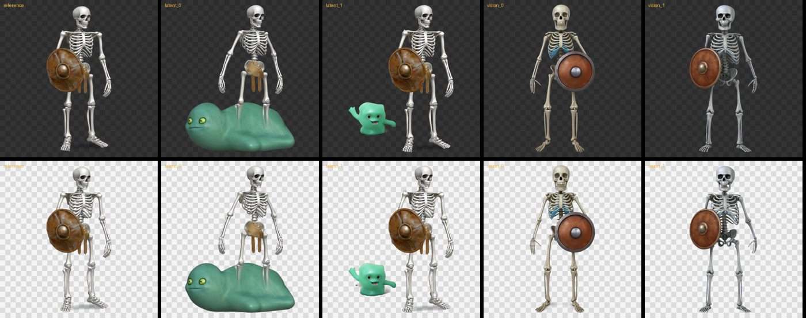
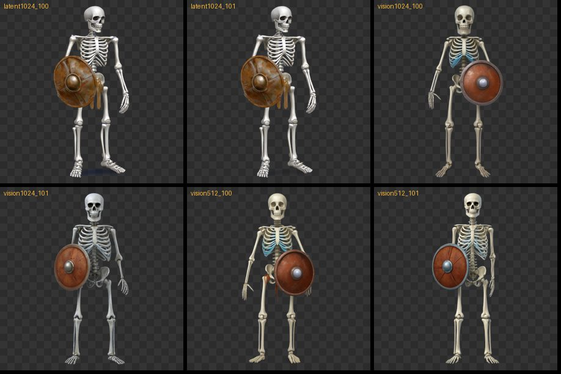
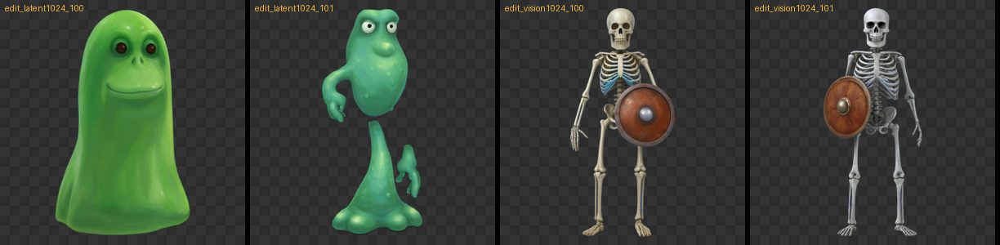
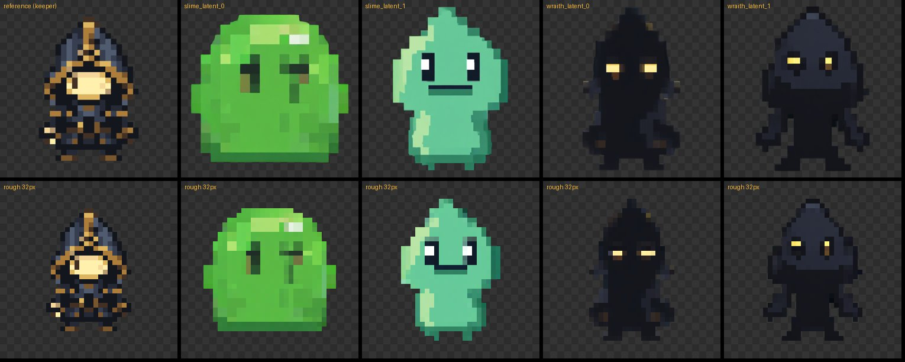

# 참고 이미지 + 투명 배경 검증 (Phase 3, T3.A.3)

_2026-09-25, RTX 4090 Laptop 16GB. 스크립트 `scripts/validate_ref_rgba.py`_

## 조건

- 참고 이미지: 앞서 이 앱으로 만든 투명 스프라이트(방패 든 해골 전사, 3D 도색 느낌, 411×842 RGBA). 4절은 LAST LIGHT 픽셀아트로 다시 확인했다.
- 요청 내용: "작은 슬라임 몬스터". 참고 이미지와 다른 대상이라서 화풍을 따른 건지 내용을 베낀 건지 구분할 수 있다.
- 그래프: Qwen-Image-2.1 + Viggle Turbo 6스텝. 참고 이미지는 `LoadImage` → `JoinImageWithAlpha` → `TextEncodeQwenImage21`의 `images.image_1`로 넣었다.
  - `latent`: VAE를 연결해 참고 잠재까지 넣는다.
  - `vision`: VAE 없이 비전 인코더만 쓴다.
- 앱과 같은 흐름으로 돌렸다: 인코딩 전용 프롬프트 → 모델만 내리기 → 후보 생성

## 결과

### 1. 계획서의 "화풍 참고" 문구 (각 방식 2장)

"Use picture 1 only as a style reference for palette, outline, shading and proportions. Draw a new subject: a small slime monster."

| 방식 | 투명 배경 | 결과 | 생성 시간 | 최대 VRAM |
|---|---|---|---|---|
| latent | 유지 | 해골을 거의 그대로 복사하고 옆에 슬라임을 덧붙임 | 12.1초, 9.1초 | 13.8GB, 14.4GB |
| vision | 유지 | 슬라임 없이 방패 든 해골을 새로 그림 | 12.2초, 7.1초 | 11.6GB, 12.2GB |

- 인코딩(모델 로드 포함): latent 9.1초, vision 8.1초
- vision 1장은 피사체가 화면 위아래 끝에 닿았다(후처리본 테두리 알파 253).

### 2. 더 강한 지시문 (latent 1024, vision 1024, vision 512 × 2장)

"... Do not include any object, character, costume or pose from picture 1."

6장 모두 해골이 나왔고 슬라임은 없었다. 참고 이미지 해상도를 512로 낮춰도 같았다. 모델이 참고 이미지를 "화풍 견본"이 아니라 "편집할 원본"으로 다룬다.

### 3. 편집 지시문 (각 방식 2장)

"Replace the subject of picture 1 with a small slime monster. Keep the same art style, palette, outline and shading as picture 1."

| 방식 | 투명 배경 | 결과 |
|---|---|---|
| latent | 유지 (테두리 알파 0) | **새 대상(슬라임)을 참고 이미지의 반들반들한 3D 도색 화풍으로 그림.** 두 번째는 해골처럼 서 있는 자세라, 구도와 비율은 참고 이미지를 따라가는 경향이 있다. |
| vision | 유지 | 여전히 해골만 그림 |

### 4. LAST LIGHT 픽셀아트 참고 이미지 (latent + 편집 문구 + 픽셀 문구, 대상 2종 × 2장)

- 참고 이미지: `<게임 프로젝트 경로>\ArtSource\LastLight\keeper\000.png` (32×32, 이진 알파, 11색, 인물은 x 7~24, y 3~28). 원본은 읽기만 하고, 복사본을 최근접 32배로 키워 1024×1024로 넣었다.
- 프롬프트: 투명 문구 + 아래 편집 문구 + 픽셀 문구. 실행기(T3.C.3)도 이 문장을 그대로 쓴다.
  - 편집 문구: `Replace the subject of picture 1 with {subject}. Keep the same art style, palette, outline and shading as picture 1. Full body, centered, one subject only, no ground, no cast shadow, no text.`
  - 픽셀 문구: `Pixel art, crisp hard-edged pixels, limited palette, no anti-aliasing.`
- 대상: "a small slime monster", "a shadow wraith enemy with glowing eyes"

_윗줄: 참고 이미지와 후처리본. 아랫줄: 32칸에 대충 줄여 본 모습(최근접 축소, 실제 픽셀 정리 아님)._

| 결과 | 투명 배경 | 생성 시간 | 최대 VRAM | 겉보기 픽셀 크기 |
|---|---|---|---|---|
| slime 0 | 유지 (테두리 알파 0) | 12.2초 | 14.2GB | 31~32px로 고름 (16×15칸) |
| slime 1 | 유지 | 9.1초 | 14.5GB | 16~47px로 들쭉날쭉 |
| wraith 0 | 유지 | 12.1초 | 13.8GB | 24~38px로 들쭉날쭉 |
| wraith 1 | 유지 | 9.3초 | 14.6GB | 29~32px로 고름 (18×26칸, keeper와 같은 크기) |

- **새 대상을 그린다.** 네 장 모두 keeper를 베끼지 않고 슬라임과 망령을 그렸다. 화풍(두꺼운 픽셀, 어두운 외곽선, 단순한 명암)은 참고 이미지를 따랐다.
- **팔레트는 대상을 따른다.** 슬라임은 참고 이미지에 없는 초록이고, 망령은 keeper의 남색과 금색을 가져왔다. "same palette"는 글자 그대로 지켜지지 않는다. 색을 묶으려면 프로젝트 고정 팔레트(`palette`)를 써야 한다.
- **자세와 크기는 참고 이미지를 따라간다.** slime 1은 keeper처럼 서 있고 머리가 뾰족하며, 망령 둘은 keeper의 두건 윤곽을 닮았다. 겉보기 픽셀 크기가 고른 두 장은 참고 이미지의 32px 격자를 그대로 이어받았다.
- **겉보기 픽셀 크기는 장마다 다르다.** 네 장 중 두 장은 격자가 고르지 않다(계획서가 예상한 문제). 픽셀 정리(T3.C.1)가 최빈 색 표본을 쓰는 이유다. 논리 캔버스에 꽉 채우는 방식(32칸에서 여백 1칸)은 18칸짜리 대상을 30칸으로 늘리므로 원래 픽셀 하나가 1~2칸이 된다. T3.D.2 결과가 뭉개지면 격자 크기 추정(T3.C.2)을 한다. 단순히 "되돌린 이미지와 차이가 가장 작은 k"를 고르면 항상 가장 작은 k(4)가 나오므로 다른 기준이 필요하다.
- **알파**: 후처리본의 부분 투명 비율(slime 46~59%, wraith 3%)이 높아 보이지만, 슬라임 몸통의 알파가 255가 아니라 254라서 생긴 수치다. 0이 아닌 픽셀의 99% 이상이 알파 128 이상이라 이진 알파로 바꿔도 몸통이 남는다.

## 결론

- **투명 배경**: 모든 조건에서 유지됐다(18장). 계획서의 대체 경로(단색 배경 키잉)는 필요 없다.
- **VRAM**: 최대 14.6GB로 16GB를 넘지 않았다. `cache_cpu`는 기본으로 켜지 않는다.
- **화풍 반영**: "참고만 하라"는 문구는 효과가 없고 내용을 베낀다. 편집 문구("picture 1의 대상을 X로 바꾸고 화풍은 유지") + `latent` 방식에서만 원하는 결과가 나왔다. 3D 도색 참고 이미지와 LAST LIGHT 픽셀아트 참고 이미지 모두 같다.
- **대가**: 결과가 참고 이미지의 구도·자세·비율을 따라간다. 스프라이트에는 오히려 규격을 맞추는 효과가 있지만, 참고 이미지와 모양이 전혀 다른 대상(예: 사람 참고로 아이콘)에서는 어색할 수 있다.

## 사용자 결정 (2026-09-25)

1. 기본 경로는 `latent` + 편집 문구로 한다. 결정 규칙 1에 해당한다.
2. 참고 이미지는 스프라이트에만 쓴다. 아이콘은 참고 이미지가 있어도 일반 문구로 생성한다.
